  

# 📊 Awesome Digital Product Analytics

> A comprehensive, SEO-optimized, curated index of world-class digital product analytics platforms, open-source user analytics engines, behavioral event streams, session replay tools, transparent SaaS pricing tiers, and market dynamics.

---

## 📑 Table of Contents
- [🌐 Sector Overview & Market Dynamics](#-sector-overview--market-dynamics)
- [💼 Commercial SaaS Product Analytics](#-commercial-saas-product-analytics)
- [🔓 Open-Source (OSS) Product Analytics](#-open-source-oss-product-analytics)
- [🔍 Key Evaluation Criteria](#-key-evaluation-criteria)
- [🤝 Contributing](#-contributing)
- [💖 Support](#-support)
- [⭐ Star History](#-star-history)
- [📄 License](#-license)

---

## 🌐 Sector Overview & Market Dynamics

The global product analytics software market is currently valued between **$10.5 billion and $14.6 billion** (projected to reach **$12.3B–$13.0B+** by 2026 at a compound annual growth rate of ~12%–15%), propelled by enterprise transition to product-led growth (PLG), AI-assisted behavioral insights, and warehouse-native event modeling. 

The industry displays a **moderately concentrated, bifurcated structure** rather than an absolute winner-take-all monopoly: while a concentrated echelon of established heavyweights (Contentsquare, Amplitude, Mixpanel, Pendo) captures large-enterprise budgets, the broader market remains highly fragmented across privacy-first web trackers, specialized session replay tools, and high-growth open-source self-hosted analytics suites.

---

## 💼 Commercial SaaS Product Analytics

The table below catalogs premier commercial digital product analytics tools, sorted descending by enterprise scale (**valuation or annual revenue run-rate**). All pricing benchmarks reflect verified entry tiers and explicit free tier or trial thresholds.

| 🏢 Product / Platform | 💰 Scale (Valuation / Revenue) | 🏷️ Starting Paid Tier | 🎁 Free Tier Limits / Free Trial | 🎯 Primary Focus & Features |
| :--- | :--- | :--- | :--- | :--- |
| **[Contentsquare](https://contentsquare.com/)** | **$5.6B Valuation** *(~$1.4B raised; acquired Heap for ~$200M)* | **Custom sales quote** *(growth plans start ~$24,000/yr)* | **Free forever plan:** up to **200,000 monthly sessions**, 10,000 session replay captures, and unlimited heatmaps *(or 15-day free trial on paid tiers)* | Enterprise digital experience intelligence, automated heatmaps, customer journey analysis, and session replay. |
| **[Pendo](https://www.pendo.io/)** | **$2.6B Valuation** *(~$100M+ ARR)* | **Custom quote** *(median SMB contracts start ~$20,000–$50,000/yr)* | **Free forever plan:** up to **500 Monthly Active Users (MAUs)** with 12-month data retention *(also offers Novus AI developer free tier)* | Product analytics combined with in-app user onboarding guides, NPS sentiment tracking, and user feedback roadmaps. |
| **[Amplitude](https://amplitude.com/)** | **$2.0B Market Cap** *(NASDAQ: AMPL; ~$410M ARR)* | **$0/mo** for first 2M events; then **usage-based starting at ~$1,200/mo** (up to 70M events) | **Free forever Starter plan:** up to **2,000,000 monthly events**, unlimited seats, core analytics, and 10k session replays/mo | Behavioral event cohorting, funnel conversion, retention analysis, feature experimentation, and predictive AI insights. |
| **[FullStory](https://www.fullstory.com/)** | **$1.8B Valuation** *(~$95M ARR)* | **Custom annual contract** *(Business tier starts ~$10,000–$25,000/yr)* | **Free forever plan ("FullStoryFree"):** up to **30,000 sessions/month**, 12-month data retention, and up to 10 user seats | High-fidelity session replay, error and frustration signal tracking (rage clicks), and conversion journey analytics. |
| **[PostHog Cloud](https://posthog.com/)** | **$1.4B Valuation** *(~$55M+ ARR)* | **$0/mo** platform fee; **$0.00005 per event** after exceeding free threshold | **Free forever plan:** up to **1,000,000 events/month**, 5,000 session replays/mo, 1M feature flag calls/mo, and unlimited seats | All-in-one developer platform: product analytics, autocapture, session replays, feature flags, A/B testing, and surveys. |
| **[Mixpanel](https://mixpanel.com/)** | **$1.05B Valuation** *(~$210M estimated ARR)* | **$0/mo base**; then **$0.00028 per event** past free cap *(Growth tier starts at $0)* | **Free forever plan:** up to **1,000,000 events/month**, unlimited team members, and 10,000 session replays/mo | Event-based product analytics, interactive retention funnels, anomaly detection, behavioral cohorting, and journey analysis. |
| **[LogRocket](https://logrocket.com/)** | **~$10M–$100M ARR** *(~$55M total funding raised)* | **$99/month** (Team tier, billed annually) | **Free forever plan:** up to **1,000 sessions/month** with 30-day retention and front-end performance logging | Frontend application performance monitoring, network telemetry recording, error logging, and session replay. |

---

## 🔓 Open-Source (OSS) Product Analytics

Self-hosted, transparent, and privacy-respecting alternatives to proprietary trackers. Sorted descending by **GitHub Stargazers**:

| 📦 Repository | ⭐ Popularity (GitHub Stars) | 🛠️ Tech Stack & Architecture | 💡 Key Strengths & Use Cases |
| :--- | :--- | :--- | :--- |
| **[PostHog](https://github.com/PostHog/posthog)** |  | Python, TypeScript, ClickHouse, Kafka | The definitive open-source product analytics suite: autocapture, session replay, heatmaps, feature flags, and A/B experimentation. |
| **[Umami](https://github.com/umami-software/umami)** |  | Next.js, Node.js, Prisma, PostgreSQL/MySQL | Ultra-lightweight, GDPR-compliant, privacy-first web and product event analytics without cookie banners. |
| **[Plausible Analytics](https://github.com/plausible/analytics)** |  | Elixir, Phoenix, ClickHouse, PostgreSQL | Lightweight (< 1 KB script) privacy-oriented analytics engine. Fully de-anonymized, cookieless, and easy to self-host. |
| **[Matomo](https://github.com/matomo-org/matomo)** |  | PHP, MySQL / MariaDB, Vue.js | The premier open-source enterprise Google Analytics alternative: complete data sovereignty, heatmaps, funnels, and tag management. |
| **[OpenReplay](https://github.com/openreplay/openreplay)** |  | Golang, TypeScript, ClickHouse, Docker | Developer-focused self-hosted session replay and bug reproduction suite. Captures network requests, redux state, and JS errors. |
| **[Highlight](https://github.com/highlight/highlight)** |  | TypeScript, Golang, ClickHouse, React | Fullstack observability and product analytics platform uniting session replay, logging, and error tracking. |
| **[GrowthBook](https://github.com/growthbook/growthbook)** |  | TypeScript, Node.js, Next.js, MongoDB | Open-source feature flagging and statistical A/B experimentation platform connecting directly to SQL data warehouses. |
| **[Snowplow](https://github.com/snowplow/snowplow)** |  | Scala, Apache Kafka, Spark, Postgres/Redshift | Industrial-grade behavioral event data pipeline for generating pristine first-party customer behavioral data streams. |
| **[Countly](https://github.com/countly/countly-server)** |  | Node.js, MongoDB, Linux | 360-degree digital product analytics for mobile apps, web applications, desktop, and IoT devices with rigorous on-premise governance. |
| **[Jitsu](https://github.com/jitsucom/jitsu)** |  | TypeScript, Go, ClickHouse, Redis | Open-source, Segment-compatible data ingestion engine and event router delivering event streams straight to data warehouses. |
| **[RudderStack Server](https://github.com/rudderlabs/rudder-server)** |  | Golang, PostgreSQL, Redis | Open-source customer data platform (CDP) core engineered for warehouse-first event tracking and downstream tool integration. |

---

## 🔍 Key Evaluation Criteria

When selecting an analytics architecture for digital applications, teams benchmark five central axes:

* 📡 **Instrumentation Paradigm:** Code-based explicit events (Mixpanel, Snowplow) vs. zero-code autocapture (PostHog, Heap).
* 🏰 **Data Sovereignty & Privacy:** On-premise self-hosted pipelines (ClickHouse, Matomo, OpenReplay) vs. turnkey SaaS multi-tenant cloud.
* 📦 **Warehouse-Native Integration:** Streaming directly into BigQuery, Snowflake, or Databricks vs. proprietary closed silos.
* 💸 **Predictable Cost Scaling:** Event-volume pricing ($/event) vs. Monthly Tracked Users (MTU) vs. Session-based billing.
* 🔬 **Qualitative vs. Quantitative:** Pure behavioral cohorts (Amplitude) vs. synchronized session replays and heatmaps (FullStory, Contentsquare, LogRocket).

---

## 🤝 Contributing

Contributions, additions, and updates are warmly welcomed! 🌟
1. Fork this repository.
2. Create a new branch: `git checkout -b feature/new-analytics-tool`.
3. Add your proposed tool in the matching section following existing formatting standards (including specific pricing, verified free-tier limits, and star badges).
4. Commit your changes: `git commit -m "feat: add [Tool Name] to digital product analytics list"`.
5. Push to the branch: `git push origin feature/new-analytics-tool`.
6. Open a Pull Request.

---

## 💖 Support

Thank you for exploring **Awesome Digital Product Analytics**! If you find this curated directory helpful for evaluating tools, building products, or architecting analytics stacks, please consider showing your support:

- ⭐ **Star** this repository to help others discover it.
- 🍴 **Fork** and contribute your favorite analytics platforms or suggestions.
- 📢 **Share** it with your developer, product, and data communities.
- ☕ **Buy me a coffee / Sponsor**: If you appreciate this work, consider supporting ongoing maintenance on the [GitHub Sponsors Dashboard](https://github.com/sponsors/ishandutta2007).

---

## ⭐ Star History

---

## 📄 License

This repository is licensed under the [MIT License](LICENSE).
